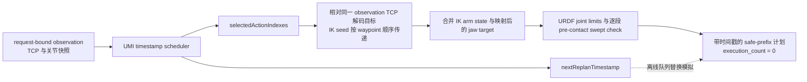

# UR5_CAD 当前系统统一审计

- 审计日期：2026-10-07
- 项目：robot-sim
- 官方 UMI 仓库：../universal_manipulation_interface

> 本文以当前 checkout 源码、实际 checkpoint 元数据和本地运行记录为证据。用户指定的 umi_system_debug_merged(2).md 在当前 checkout 中未找到；本次以 ../doc/umi_system_debug_merged.md（文档标注审计日期 2026-10-03）作为历史清单，并用当前源码逐项复核。旧文档保持原样，仍是 historical baseline；本文是 UR5_CAD current source of truth。
>
> 本次复核了当前官方源码、checkpoint 元数据和既有日志，并实现了纯时间戳调度干跑与 synthetic timestamp tests。没有运行真实 Cup Approach，也没有执行机器人动作。debug 下的 JSON 是本机生成记录，已在本文中提炼关键结果。

## 最终判定

| 问题 | 判定 | 依据 |
|---|---|---|
| A. action0-only Cup Approach 是否等价于官方 UMI deployment execution semantics？ | **NO** | Cup Approach 每轮执行该轮预测的 action index 0，执行后重新观测和推理；官方 eval_real_umi 按 action timestamps 去掉过期动作并将仍有效的动作目标排入机器人控制器。两者的动作选取、提交方式和重规划时间轴不同。 |
| B. 具体差异 | **每次实际执行数量、动作时间安排、提交方式和延迟处理不同** | Cup Approach 每轮实际 playback 仅有 index 0，尽管先对 index 0–5 做 IK dry-run。官方没有固定执行 action[0:6] 的切片；它基于预测时间戳筛动作并调度目标。仿真日志标记 latency compensation 为 0，官方环境则按控制器延迟补偿目标时间。 |
| C. 后续完整 action_pred 是否预测了比 action0 更明显的运动？ | **YES** | 6088 运行的 20 轮中，action0 目标位移中位数为 0.686 mm，而每轮 16 项预测的最大目标位移中位数为 24.524 mm；far-cup Step 18 中 action0 为 0.357 mm，action15 为 19.567 mm。每项都是相对同一观测 TCP 的目标位姿。 |
| D. 是否已有充分证据进入 bounded action-chunk execution？ | **NOT_READY** | 已证明单动作闭环可运行、完整预测包含未来目标，并且普通仿真代码能选择六项；尚无 Cup Approach 动作块实际执行记录。成功的 20 轮记录每轮只执行 index 0；far-cup Step 18 的动作块被 action0 的 no-motion / safety gate 挡住，后续动作只是干跑。现有接触前保护只审查本轮唯一执行目标，不能代表未来整段都通过保护。 |

这里的 NOT_READY 指缺少对受限动作块的完整执行与安全证据，不表示官方或仿真策略输出不可读。当前 20-step 结果证明的是“每轮执行一个动作后重新观测”，不是“连续执行预测动作段”。

## 当前真实链路与代码边界

~~~mermaid
flowchart LR
  subgraph SIM["robot-sim 路径"]
    A["UR5_CAD 仿真<br/>CUSTOM"] --> B["WristCameraCapture<br/>CUSTOM"]
    B --> C["Observation 与 TCP snapshot<br/>CUSTOM"]
    C --> D["WebSocket / FastAPI<br/>CUSTOM"]
    D --> E["UMI worker 适配器<br/>CUSTOM"]
    E --> F["官方 observation preprocessing<br/>OFFICIAL UMI"]
    F --> G["policy.predict_action<br/>OFFICIAL UMI"]
    G --> H["完整 action_pred<br/>OFFICIAL UMI"]
    H --> I["执行时域选择与 action slicing<br/>CUSTOM"]
    I --> J["relative pose composition<br/>CUSTOM"]
    J --> K["浏览器 IK<br/>CUSTOM"]
    K --> L["通用安全检查<br/>CUSTOM"]
    L --> M["Cup Approach pre-contact guard<br/>CUSTOM"]
    M --> N["仿真 playback<br/>CUSTOM"]
    N --> O["actual_after_action 与 review JSON<br/>CUSTOM"]
    O --> P["严格更新的相机帧<br/>CUSTOM"]
    P --> C
  end
  subgraph REAL["官方实机评估参考路径"]
    G --> Q["eval_real_umi 时间戳筛选<br/>OFFICIAL UMI"]
    Q --> R["UmiEnv.exec_actions<br/>OFFICIAL UMI"]
    R --> S["RTDE waypoint 控制器<br/>OFFICIAL UMI"]
  end
  classDef custom fill:#e8f1ff,stroke:#3973ac,color:#17324d;
  classDef official fill:#e7f5e8,stroke:#43824a,color:#18391b;
  class A,B,C,D,E,I,J,K,L,M,N,O,P custom;
  class F,G,H,Q,R,S official;
~~~

robot-sim 的仿真、相机、observation 适配、WebSocket、后端、worker 启动、动作切片、相对位姿组合、IK、夹爪映射、保护逻辑和 playback 均为自定义实现。官方 UMI 提供 checkpoint、policy、图像与状态 preprocessing、pose representation 工具和实机 eval / environment。仿真 worker 调用官方 preprocessing 与 policy，但这不使浏览器执行路径等价于官方实机部署。

当前适配链证据：server/load_model.py:31-37,119-156；../universal_manipulation_interface/scripts/umi_sim_replay_worker.py:152-178,202-237；src/app/useInferenceReplay.ts:715-829,859-942；src/workers/umiIk.worker.ts:33-52,147-157,197-234。

## UR5_CAD 几何、TCP 与夹爪

UR5_CAD 使用 public/robot/ur_umi_real/urdf/ur5_umi_real.urdf，robot config 的 tip link 是 umi_tcp_link，运动模式为浏览器运动学 FK。CAD mount 通过固定关节连到 tool0；UMI TCP 再通过固定变换连到末端工具。当前 tool0 到 umi_tcp_link 的变换为 xyz=(0, -0.0036, 0.224785782) m、rpy=(0, 0, 0)。CAD 网格保留 STEP 全局坐标导出的实体；左右 jaw 使用独立 prismatic joint。证据：src/app/config.ts:57-79；public/robot/ur_umi_real/urdf/ur5_umi_real.urdf:292-325,357-392；public/robot/ur_umi_real/README.md:1-16。

URDF 声明的 UR5 六轴限位中，shoulder pan/lift 与 wrist joints 为 ±2π，elbow 为 ±π。它们是当前仿真 URDF 的限位声明；源码本身不能证明这些限位与某台实机控制器的已校准限位一致。证据：public/robot/ur_umi_real/urdf/ur5_umi_real.urdf:211-256。

UR5_CAD IK tolerance 是 position 0.0005 m、orientation 0.001 rad。浏览器使用自定义阻尼最小二乘雅可比求解，最多 100 次迭代，damping 0.05，并对每步关节变化和 URDF 限位作约束。证据：src/app/config.ts:76-79；src/core/Kinematics.ts:135-163,178-215,300-360；src/workers/umiIk.worker.ts:19-30。

输入的 gripper width 表示总开口宽度。映射器按真实 left_jaw_joint 与 right_jaw_joint 各自 0–0.055 m 的行程，将开口宽度分配到两侧 jaw；总最大开口为 0.11 m。证据：src/app/config.ts:74-75；src/app/gripperMapping.ts:12-29,57-82；URDF:368-391。

## 固定腕部相机与 observation

策略相机固定安装在 CAD mount_link 下。WristCameraCapture 按相机配置设置 GoPro 相机 anchor 的本地位置和方向，再将其挂到 mount_link。相机位姿不再使用杯子的 world pose 调用 lookAt。场景 UI 的 OrbitControls 会调整操作者看到的场景视角；那台场景观察相机不是送入 policy 的腕部相机。证据：src/sim/sensors/WristCameraCapture.tsx:99-139；src/sim/sensors/wristCameraConfig.ts:1-16；src/viz/SceneManager.tsx:178-207。

虚拟 GoPro 图像从 448×252 中央裁成正方形，缩放到 224×224，读回时翻转纵向像素并输出 RGB；相机按 50 ms 间隔更新。相机光心、实际 FOV 和真实 GoPro 到 TCP 的外参仍需要实体标定。证据：src/sim/sensors/WristCameraCapture.tsx:30-54,193-245；src/sim/sensors/wristCameraConfig.ts:3-16。

每次 observation 包含一帧 224×224 RGB、两帧 EEF position / axis-angle / gripper width，以及 observation frame index 和相机 frame index、timestamp。前端保存同一份 observation snapshot；动作返回时校验 episode 与 frame index，后端也将 worker 结果绑定回发起请求的上下文。证据：src/app/App.tsx:479-528；src/app/useInferenceReplay.ts:715-829,859-890；server/inference.py:64-120,129-155；server/load_model.py:278-355。

worker 将 RGB 解码为图像数组并调用官方 get_real_umi_obs_dict；当前图像历史为 1 帧，本体状态历史为 2 帧。官方 helper 按 checkpoint shape metadata 进行图像变换、uint8 到 [0,1] 的归一化和 THWC→TCHW 转换。与旧审计相比，当前 checkpoint 的图像 horizon 确认为 1，当前本体状态 horizon 确认为 2。证据：../universal_manipulation_interface/scripts/umi_sim_replay_worker.py:152-178,202-231；../universal_manipulation_interface/umi/real_world/real_inference_util.py:62-117。

## 当前 checkpoint 与 action_pred

服务端固定加载 ../universal_manipulation_interface/data/pretrained/cup_wild_vit_l_1img.ckpt。当前 checkpoint 的 archive/data.pkl 以 pickle opcode 静态检查，没有反序列化模型或运行 forward。提取到的 cfg 为：

| 字段 | 当前值 | 含义 |
|---|---:|---|
| task.img_obs_horizon | 1 | 每次推理使用一帧图像 |
| task.low_dim_obs_horizon | 2 | 每次推理使用两帧低维状态 |
| task.action_horizon | 16 | 一次预测包含 16 个未来 action pose |
| pose_repr.obs_pose_repr | relative | observation pose 表示 |
| pose_repr.action_pose_repr | relative | 预测 action pose 表示 |
| cfg.n_action_steps | 8 | checkpoint 中存在的配置字段；当前 TIMM policy 和实机 eval 不用它固定切出 8 项执行动作 |

实际 prediction 日志的每个动作宽度为 10，shape 为 [16,10]；保留 batch 的 policy 输出为 [B,16,10]。每行布局是 xyz 平移 3 维、rotation_6d 6 维、绝对 gripper opening 1 维。rotation_6d 使用前两行矩阵布局；转换为 rotation matrix 时按官方实现正交化。证据：server/load_model.py:31-37,151-156；../universal_manipulation_interface/diffusion_policy/policy/diffusion_unet_timm_policy.py:37-42,68,137,155-162；../universal_manipulation_interface/umi/common/pose_util.py:86-114；server/logs/inference-predictions.jsonl:113,133。

官方辅助函数 get_real_umi_action 将 10D pose 转成矩阵，按 checkpoint 的 action_pose_repr 解码，再转成 xyz + axis-angle + gripper 的 7D 环境动作；action pose 的 6D rotation 与 gripper 不可混为一组相对增量。证据：../universal_manipulation_interface/umi/real_world/real_inference_util.py:175-205。

## relative action 的参考位姿

当前 action_pose_repr=relative 时，action_pred[i] 的每个 pose 都相对于生成这次 prediction 的同一个最新 observation TCP pose：

T_target[i] = T_observation × T_relative[i]

它不是以前一个 action 目标为参考。官方训练/转换工具的 relative 编码为 inverse(T_base) × T_pose，解码为 T_base × T_relative；只有 delta 表示才逐点差分并累计。证据：../universal_manipulation_interface/diffusion_policy/common/pose_repr_util.py:48-77,81-109；../universal_manipulation_interface/umi/real_world/real_inference_util.py:179-198。robot-sim worker 对整段 action 使用同一个 request.startPose，浏览器 composePoses 也按 observation snapshot 的 TCP 姿态合成每个目标。证据：src/workers/umiIk.worker.ts:147-157,197-234,283-310；src/utils/math.ts:111-114。

因此，action index 15 的 target displacement 是从当前 observation TCP 到第 15 项目标的偏移，不是把 index 0–15 的相对平移逐个相加后的总和。trajectory_summary 中的 cumulative_path_mm 才是沿这些目标点依序连接得到的路径长度。

## 官方实机 inference 与 execution 时序

当前官方脚本的 `frequency=10 Hz`，所以 `dt = 1 / frequency = 0.1 s`。每轮在 `env.get_obs()` 后运行 `policy.predict_action`，把 `result['action_pred'][0]` 转为环境动作。时间戳按 `action_timestamps = np.arange(len(action), dtype=np.float64) * dt + obs_timestamps[-1]` 生成，其中 `obs_timestamps[-1]` 是 observation 相机时间戳。过滤使用 `curr_time = time.time()` 和源码常量 `action_exec_latency = 0.01`：只保留 `action_timestamps > curr_time + action_exec_latency`，等于 cutoff 的 action 也过期。证据：`../universal_manipulation_interface/scripts_real/eval_real_umi.py:86-89,390-418`。

如果没有任何 timestamp 通过筛选，官方保留 `this_target_poses[-1]`，计算 `next_step_idx = ceil((curr_time - eval_t_start) / dt)`，并将它的时间改为 `eval_t_start + next_step_idx * dt`。否则，原样选择所有通过筛选的 action 和 timestamp。这里的 `steps_per_inference=6` 不切片预测数组；它参与 `t_cycle_end = t_start + (iter_idx + steps_per_inference) * dt`，每轮完成后 `iter_idx += steps_per_inference`，因此默认每 0.6 秒推进一次 inference 周期，并在 `precise_wait(t_cycle_end - frame_latency)` 后取下一 observation。官方设置 `frame_latency = 1/60 s`。证据：`../universal_manipulation_interface/scripts_real/eval_real_umi.py:86-89,386-437,479-481`。

`UmiEnv.exec_actions(compensate_latency=True)` 在接收时用 `receive_time=time.time()` 再筛一次 `timestamps > receive_time`；这层没有 fallback。剩下的每个机器人 waypoint 时间设为 `timestamp - 0.18 s`，每个 gripper waypoint 时间设为 `timestamp - 0.1 s`。这些延迟来自本次 eval 创建 UmiEnv 时设置的 `robot_action_latency`、`gripper_action_latency`，不是 policy scheduler 的 0.01 s stale cutoff。UR5 控制器以 500 Hz 运行。证据：`../universal_manipulation_interface/scripts_real/eval_real_umi.py:136-169`；`../universal_manipulation_interface/umi/real_world/umi_env.py:231-250,446-483`。

RTDE `schedule_waypoint` 将每项命令各自放入容量 256 的 FIFO shared-memory queue，控制进程每 500 Hz 最多取一项；队列不会把新 inference 的命令合并成一个 chunk。控制进程把 Unix timestamp 转为 monotonic 时间，再调用 `PoseTrajectoryInterpolator.schedule_waypoint`。新目标时间不晚于当前插入时间时插值轨迹不变；新目标位于当前时间之后且不晚于已有最后 waypoint 时，会裁掉当前时刻后的旧未来轨迹并插入新目标；晚于已有最后 waypoint 时则延续轨迹追加。速度约束还可能把实际 waypoint 到达时间推后。证据：`../universal_manipulation_interface/umi/real_world/rtde_interpolation_controller.py:109-113,199-208,249-305,331-345`；`../universal_manipulation_interface/umi/common/pose_trajectory_interpolator.py:117-185`。

checkpoint 的 `n_action_steps=8`、16 项 `action_pred` 与 eval 的 `steps_per_inference=6` 是不同概念。eval 不保证每轮恰好提交六项，也不保证 index 0 未过期；下一轮较早的 waypoint 可以替换控制器插值器里尚未到达的未来轨迹。

## Official-style timestamp scheduling implementation

新增 `src/app/umiActionScheduler.ts` 作为纯函数调度器。它仅根据完整动作数、相机 observation timestamp、推理请求/响应时间、10 Hz、steps_per_inference、官方 stale cutoff lead time 和仿真 command latency 返回时间索引、过期项、fallback、每项时间诊断与下一次重规划时间；它不执行 IK、playback、gripper 或 SceneManager 更新。页面的 UR5_CAD dry-run 获取一帧 observation 并进行一次完整 policy inference，拿到完整 `action_chunk` 后即计算并停止；`execution_count=0`、`ik_count=0`、`playback_count=0`、`gripper_command_count=0`。

**OFFICIAL UMI semantics**：动作时间戳锚定最新 observation camera timestamp；过期比较为严格 `action_timestamp > current_time + 0.01 s`；全过期时只回退最后一项，按 `eval_t_start + ceil((current_time-eval_t_start)/dt) * dt` 设时间。下一次 inference deadline 使用 `eval_t_start + (iteration_index + steps_per_inference) * dt - frame_latency`。`frequency=10 Hz` 同时决定动作间隔和高层时间步长；`steps_per_inference=6` 推进 6 个时间步。

**ROBOT-SIM approximation**：相机帧、observation 创建、WebSocket 请求/响应和调度当前时间统一使用浏览器 `performance.now()` 的毫秒值，时序记录不与 `Date.now()` 或 Python 时间比较。browser dry-run 将新 observation 的相机 timestamp 加官方 `frame_latency=1/60 s` 作为单次周期的 `eval_t_start` 近似值，当前只有 iteration index 0。官方评估 stale cutoff 的 0.01 s 作为单独参数保留；仿真没有实测 controller command latency，`simulated_command_latency_seconds=0`，事件记录 `SIMULATION_LATENCY_ASSUMPTION=0`。因此本 dry-run 可以核对同一浏览器时钟上的调度索引，但不代表真实 RTDE 延迟补偿或完整实机 timing。

`action_pose_repr=relative` 的目标位姿仍全部使用本次 observation TCP：`T_target[i] = T_observation @ T_relative[i]`。scheduler 只返回 index，不重写 pose reference。far-cup Step 18（`request_id=a1932a9db3d040f190248efa7d857497`）没有 observation 创建、推理请求发送和推理响应接收的同一时钟记录，因此 `HISTORICAL_EXACT_SELECTION = INCONCLUSIVE`；既有 16 项预测仍可核对 action index、相对位姿参考和时间戳相对结构，不能据此还原当时 selected indexes。

Synthetic timestamp tests 覆盖 10 Hz/16 项、230 ms inference latency、全过期 fallback、6-step replan cadence、零仿真 command latency、非零 stale lead、同一 monotonic clock 与 16 个共享 observation TCP 参考的目标。普通单动作、3-step/10-step auto-loop、Cup Approach action0-only 和普通 action chunk 执行仍走原分支，scheduler 结果不会传入执行路径。

## robot-sim 的 action slicing 与执行时域

| 模式 | 每次 inference 后干跑的 index | 实际 playback 的 index | 下一轮 |
|---|---|---|---|
| 普通动作块回放 | 默认选择 [0,1,2,3,4,5] 并逐项求 IK | 整段通过后执行所选动作 | 普通流程等待 ACK 后的人为下一次推理 |
| single-action | [0,1,2,3,4,5] | 仅 index 0 | 等待人工审阅 / 执行 |
| 3-step bounded auto-loop | 每轮 [0,1,2,3,4,5] | 每轮仅 index 0；总计最多 3 轮 inference-action-observation | 保存 review，再等严格更新相机帧 |
| 10-step bounded auto-loop | 每轮 [0,1,2,3,4,5] | 每轮仅 index 0；总计最多 10 轮 inference-action-observation | 保存 review，再等严格更新相机帧 |
| 20-step Cup Approach | 每轮 [0,1,2,3,4,5] | 每轮仅 index 0；总计最多 20 轮 inference-action-observation | 保存 review，再等严格更新相机帧，并记录 cup/TCP 评估 |

通用执行选择器默认 horizon=6，取 actions.slice(0,6)。single-action 分支筛出第一个选中项用于 playback；auto-loop 仍使用该分支，因此每轮实际只执行 action index 0。快照字段 selected_action_indexes=[0] 与 ik_dry_run_action_indexes=[0,1,2,3,4,5] 分别记录真实选择和额外干跑范围。证据：src/app/executionHorizon.ts:1-24；src/app/useInferenceReplay.ts:907-942,1008-1033,1327-1333,1890-1953。

因此，本轮 Cup Approach 的 action0-only 是为了此前安全审阅而采用的保守执行策略，不等同于官方 UMI deployment execution semantics。20-step 代表最多 20 次重新观测与推理，不代表执行一个 20 项预测块。

## IK、安全检查、Cup Approach 与相机同步

浏览器 IK 由自定义 worker 执行。普通动作块对选择的全部动作预求解，IK seed 会按已求解的 joint target 向后传递；action pose 仍各自以 observation TCP 为参考。single-action / auto-loop 允许后续 dry-run 错误仍生成 action0 review，但最后仅保留 index 0 playback。证据：src/workers/umiIk.worker.ts:197-234,283-310；src/app/useInferenceReplay.ts:1008-1033,1430-1442。

普通动作块只有在所有选中目标均求解成功后才建立 playback；非 single-action 模式遇到 IK 失败会终止该块。single-action 模式为审阅继续干跑后续目标，但不会把它们加入 playback。证据：src/workers/umiIk.worker.ts:92-119,141-144；src/app/useInferenceReplay.ts:997-1033。

通用安全条件要求 IK 成功、关节目标非零、必要数值有效且关节在 URDF 限位内。Cup Approach 只有 action0 满足基本条件时才调用 pre-contact guard。guard 使用杯子 world AABB、当前 URDF visual mesh 与关节路径进行接触前几何评估；必要输入或几何缺失时 fail-closed，非 SAFE_TO_EXECUTE 会在动作前停止。它是几何间距保护，不是物理接触传感器或实机防碰认证。证据：src/app/useInferenceReplay.ts:1232-1281,1273-1302；src/sim/tasks/cupApproachPreContactSafety.ts:62-127,155-225,340-398,499-565。

每轮 playback 后记录仿真 joint snapshot、FK TCP、gripper 与 observation。auto-loop 要求执行后相机 frame index 与 timestamp 都严格前进，执行后状态有效并且 review JSON 保存成功，才会继续下一轮。等待新帧超时为 1000 ms。证据：src/app/useInferenceReplay.ts:2072-2178,2220-2255,2312-2395；src/app/freshCameraFrame.ts:45-103；src/app/useInferenceReplay.ts:1763-1852。

这里的 actual_after_action 是仿真模型状态与下一张虚拟相机图像，不是实体 UR5 传感器回读。持久化目标包括 server/logs/inference-predictions.jsonl、server/logs/ik-debug.jsonl、server/logs/inference-actions.csv、debug/ur5-cad-single-action-review.json 和 debug/ur5-cad-auto-loop/{run_id}-step-{n}.json。自动闭环要求 review 写盘成功后才能进入下一步。证据：server/prediction_log.py:8-38；server/ik_debug_log.py:8-27；server/action_log.py:8-63；server/main.py:22-26,42-117；src/app/useInferenceReplay.ts:331-404,2312-2395。

文档差异：server/logs/README.md:11 仍称 IK 日志的 action_pose_repr 为 unavailable；当前 worker 会将该字段作为 available 写入。本文采用当前源码与运行日志为准。

## 既有运行记录与完整未来轨迹

### 6088：完成 20 轮 action0-only Cup Approach

本机目录 debug/ur5-cad-auto-loop/6088acd9-00ab-45a9-b19c-597203556f61-step-1.json 至 step-20.json 共 20 个快照。全部 review_status=COMPLETED，全部 selected_action_indexes=[0]，全部有 actual_after_action。杯中心到 TCP 的距离从 Step 1 前的 212.793 mm 降到 Step 20 后的 207.012 mm，净减少 5.781 mm；中间距离有回升，故这证明闭环运行完成和轻微净接近，不代表已接触杯子或达到抓取成功。

对该运行 20 次 inference 的完整 16 项预测统计：action0 target displacement 范围 0.295–2.495 mm，中位数 0.686 mm；每轮 16 项中最大 target displacement 的中位数为 24.524 mm。逐轮 action0 位移除以该轮最大预测位移的中位数为 2.39%。这说明在这组运行样本中 action0 通常是小的当前起步目标，而后续预测包含更长的目标位移；由于 pose 是相对同一 observation，这些不是连续叠加的增量。

6088 Step 18 的预测 request 为 bbbd2c70054c42f29729924b8730bdec。代表目标如下，距离单位为 mm，旋转量为 mrad，gripper 为绝对开口：

| index | 相对平移 xyz（TCP 局部） | 目标位移范数 | 旋转范数 | gripper | target ΔTCP xyz（机器人基座） |
|---:|---|---:|---:|---:|---|
| 0 | [0.428, 0.121, 0.299] | 0.536 | 0.595 | 61.842 | [0.116, 0.425, -0.305] |
| 1 | [-0.822, -0.411, 1.493] | 1.753 | 2.832 | 61.894 | [-0.441, -0.836, -1.477] |
| 5 | [-0.708, -2.797, 1.189] | 3.121 | 7.849 | 65.238 | [-2.821, -0.714, -1.128] |
| 10 | [-3.318, -2.405, -1.958] | 4.542 | 24.509 | 82.133 | [-2.374, -3.293, 2.036] |
| 15 | [-1.051, 2.895, -21.136] | 21.359 | 45.198 | 82.054 | [3.296, -0.849, 21.086] |

该 20 轮 run 每轮真实 playback 仍只有 index 0。比如 Step 20 的 actual_after_action 记录了新 observation、相机帧推进以及仿真 TCP 到目标误差约 0.022 mm；它不能证明同一轮 index 1–15 被执行。证据：debug/ur5-cad-auto-loop/6088acd9-00ab-45a9-b19c-597203556f61-step-20.json；server/logs/inference-predictions.jsonl:113。

### far-cup：Step 18，完整 action_pred[0:16]

request a1932a9db3d040f190248efa7d857497 属于 run ed6e98b4-e7b3-4b57-97d9-b167e3048cef，episode 0、frame 34、Step 18。以下 translation 和 target displacement 单位为 mm，旋转范数单位为 mrad，gripper 为绝对开口 mm。相对平移来自原始预测；target ΔTCP xyz 是将该 relative pose 用同一 observation TCP pose 组成后在机器人基座方向表达的位移。6D rotation 按官方 rot6d_to_mat 规则转换为旋转矩阵后求角度范数。

| index | 相对平移 xyz（TCP 局部） | 目标位移范数 | 旋转范数 | gripper | target ΔTCP xyz（机器人基座） |
|---:|---|---:|---:|---:|---|
| 0 | [0.331, 0.062, 0.117] | 0.357045 | 0.584 | 61.220 | [0.060, 0.330, -0.123] |
| 1 | [-1.051, -0.383, 1.161] | 1.612490 | 3.641 | 61.355 | [-0.403, -1.068, -1.139] |
| 2 | [-0.898, -1.569, 1.020] | 2.075442 | 7.640 | 61.931 | [-1.587, -0.912, -0.978] |
| 3 | [-2.425, -1.518, 1.305] | 3.144135 | 8.105 | 62.475 | [-1.541, -2.443, -1.242] |
| 4 | [-2.131, -1.428, 0.774] | 2.679181 | 8.847 | 63.392 | [-1.442, -2.141, -0.717] |
| 5 | [-2.043, -1.589, -0.252] | 2.600517 | 12.054 | 64.910 | [-1.584, -2.039, 0.310] |
| 6 | [-1.279, -1.771, -1.785] | 2.821455 | 14.372 | 66.739 | [-1.739, -1.252, 1.835] |
| 7 | [-1.150, -1.259, -2.623] | 3.128834 | 13.468 | 68.573 | [-1.212, -1.112, 2.662] |
| 8 | [-1.894, -0.466, -3.074] | 3.640694 | 10.941 | 73.655 | [-0.411, -1.850, 3.109] |
| 9 | [-2.916, -0.810, -3.345] | 4.510692 | 13.141 | 81.425 | [-0.751, -2.867, 3.401] |
| 10 | [-2.020, -1.713, -4.535] | 5.252083 | 16.407 | 82.066 | [-1.631, -1.954, 4.594] |
| 11 | [-2.960, -1.928, -5.872] | 6.852966 | 16.549 | 82.384 | [-1.823, -2.874, 5.948] |
| 12 | [-2.205, -1.543, -7.414] | 7.886774 | 17.679 | 82.342 | [-1.410, -2.096, 7.471] |
| 13 | [-3.068, -0.475, -10.988] | 11.418111 | 19.390 | 82.215 | [-0.278, -2.908, 11.038] |
| 14 | [-3.099, 0.597, -15.523] | 15.840190 | 24.557 | 82.098 | [0.875, -2.874, 15.553] |
| 15 | [-4.408, 2.091, -18.948] | 19.566557 | 33.295 | 81.995 | [2.430, -4.134, 18.970] |

Step 18 action0 的 target displacement 是 0.357045 mm，旋转范数 0.000584 rad；IK 迭代数为 0，arm joint delta 为 0。IK dry-run 汇总中第一个非零 arm target 是 index 1。该轮 selected_action_indexes=[0]，ik_dry_run_action_indexes=[0..5]，safety_verdict=BLOCKED、review_status=NOT_READY_FOR_EXECUTION；动作后 TCP、杯子和距离字段均为 null。因此 index 1–5 的值是预测和 IK dry-run 证据，不是已执行动作；index 6–15 只有预测证据，没有 IK dry-run 可达性结论。完整 prediction 在 server/logs/inference-predictions.jsonl:133，运行快照在 debug/ur5-cad-auto-loop/ed6e98b4-e7b3-4b57-97d9-b167e3048cef-step-18.json，IK trace 在 server/logs/ik-debug.jsonl:1071-1082。

两组 Step 18 都显示 action0 小于后续 horizon 目标：6088 的 action0 为 0.536 mm、index15 为 21.359 mm；far-cup 的 action0 为 0.357 mm、index15 为 19.567 mm。故 action0-only 会丢掉该次 policy prediction 的大部分未来轨迹信息。

## 历史审计结论迁移表

下表中的状态针对 2026-10-03 历史结论在当前 UR5_CAD 源码中的有效性。STILL_VALID 表示原结论仍适用；FIXED 表示原问题已经有当前实现；REPLACED 表示当前实现或架构已取代旧行为；OBSOLETE 表示旧模型下的结论不再适用于当前对象；NEEDS_RECHECK 表示仍缺少足够证据。

| # | 旧审计主题 | 当前状态 | 当前判定与证据 |
|---:|---|---|---|
| 1 | robot model | REPLACED | 旧 ReBot RS 模型已换为 UR5 + CAD UMI 末端 URDF；src/app/config.ts:57-75。 |
| 2 | tip link / TCP | REPLACED | 当前 tip link 是 umi_tcp_link，旧 gripper_end / RS TCP 结论不再适用；URDF:292-325。 |
| 3 | camera mount | FIXED | policy camera 由 CAD mount_link 刚性承载；相机光心与实机外参标定仍需复核；WristCameraCapture.tsx:99-139。 |
| 4 | camera lookAt | FIXED | policy 相机不再根据 cup world pose 朝向杯子；SceneManager 的 UI 观察相机是另一条视图链；WristCameraCapture.tsx:99-139、SceneManager.tsx:178-207。 |
| 5 | image preprocessing | NEEDS_RECHECK | 当前已改为固定 GoPro crop + 官方 observation helper；仿真图像与当前 checkpoint 训练图像的视觉分布尚无逐帧对照；src/sim/sensors/WristCameraCapture.tsx:193-245、../universal_manipulation_interface/umi/real_world/real_inference_util.py:76-91。 |
| 6 | action_pose_repr | FIXED | 字段从 worker 输出经服务端传到浏览器，并按 relative 解码；server/inference_protocol.py:110-138、src/app/useInferenceReplay.ts:649-655、src/workers/umiIk.worker.ts:89-109。 |
| 7 | WebSocket protocol | REPLACED | 当前协议携带 request_id、episode/frame 和 action_pose_repr，并校验 observation/action frame 绑定；server/inference.py:64-120、src/app/useInferenceReplay.ts:859-890。 |
| 8 | observation history | FIXED | checkpoint 图像 horizon=1、低维状态 horizon=2，与当前 1 帧图像 + 2 帧状态相符；worker 与 checkpoint shape metadata 如上。 |
| 9 | request-bound snapshot | FIXED | 浏览器使用发起 inference 的 observation TCP snapshot，并校验 episode/frame；useInferenceReplay.ts:859-890。 |
| 10 | IK tolerance | FIXED | 当前 UR5_CAD 为 0.5 mm / 0.001 rad；src/app/config.ts:76-79。 |
| 11 | IK solver | STILL_VALID | 自定义阻尼雅可比 IK 仍没有单调残差保证；其当前行为需按新的 CAD 运动范围与分块目标另行评估；src/core/Kinematics.ts:178-215,300-360。 |
| 12 | joint limits | OBSOLETE | 旧 RS 的 joint2/joint3 限位分析不适用于当前 UR5_CAD；使用当前 URDF 声明的 UR5 限位；URDF:211-256。 |
| 13 | gripper mapping | FIXED | 已按左右独立 jaw 与 CAD 行程映射；gripperMapping.ts:12-29,57-82。 |
| 14 | prediction horizon | STILL_VALID | 当前 checkpoint 仍输出 16 项 action_pred；checkpoint action_horizon=16，运行日志每行 16×10。 |
| 15 | execution horizon | REPLACED | 当前普通仿真默认 6 项；auto-loop 每轮执行 1 项；官方实机按 timestamps 调度。 |
| 16 | action slicing | REPLACED | 不能把预测 16 项直接视为每轮实际执行项；auto-loop 实际仅 index 0，普通回放选择 index 0–5。 |
| 17 | latency compensation | STILL_VALID | 仿真审阅记录 compensation steps=0；官方实机按 env controller latency 调整 waypoint 时间；src/app/useInferenceReplay.ts:658-662、../universal_manipulation_interface/umi/real_world/umi_env.py:446-483。 |
| 18 | ACK | REPLACED | 完成动作后仍有 ACK；普通流程仍等人工继续，而 auto-loop 会在 review 保存与新帧通过后发起下一 inference；src/app/useInferenceReplay.ts:2271-2295,2312-2395。 |
| 19 | auto-loop | FIXED | bounded 3 / 10 与 Cup Approach 20 步模式已实现；这些数值是 inference-action-observation 轮数，不是每轮动作数量；src/app/useInferenceReplay.ts:1890-1953。 |
| 20 | camera freshness | FIXED | auto-loop 等待严格增加的 frame index 与 timestamp，并在发送下一 observation 前再次校验；src/app/freshCameraFrame.ts:45-103、src/app/useInferenceReplay.ts:1763-1852。 |
| 21 | review persistence | FIXED | 单动作与每轮 auto-loop review 写入 JSON；下一轮依赖保存成功；server/main.py:22-26,42-117、src/app/useInferenceReplay.ts:331-404,2312-2395。 |
| 22 | Cup Approach | FIXED | 20 轮闭环已有一次完整 run；日志证明的是 action0-only 和距离变化，不构成接触、抓取或完整动作块成功证明。 |
| 23 | pre-contact safety | FIXED | 已有 fail-closed 的 CAD visual mesh / cup AABB 接触前保护；当前 Cup Approach 每轮只保护并执行 action0；src/sim/tasks/cupApproachPreContactSafety.ts:62-127,340-398,499-565。 |

## 已知限制与后续判定门槛

1. 6088 记录证明 20 轮 action0-only 闭环完成，TCP 到杯中心净接近 5.781 mm；运行未记录物理接触、杯子抓取或任务阈值达成。
2. far-cup Step 18 的 action0 在 IK tolerance 内，因此迭代数为 0、arm joint delta 为 0，随后被执行门禁阻断。它不能证明后续 chunk 不可执行；index 1–5 有干跑结果，index 6–15 没有 IK 结果。
3. 20-step Cup Approach 的安全检查目前覆盖当轮 action0。进入 Cup Approach chunk 行为评估前，需要逐项确认计划执行 target 的 IK 和整段 pre-contact 路径，再取得真实 playback 与执行后新帧证据。
4. 本地日志没有 3-step / 10-step run 快照可用于复核；源码支持这两种轮数，用户提供的“已通过”状态不等于当前目录可独立重建的运行证据。
5. 现有 playback 与 Cup Approach 执行路径仍不使用官方 action timestamps；新增模块只生成 dry-run 结果，不驱动执行。仿真没有实测 RTDE/controller latency，actual_after_action 与相机图像均来自浏览器模型。
6. policy 图像处理代码路径已对齐官方 helper，但 GoPro 镜头模型、TCP-camera 实体外参和训练图像分布还没有做实测对照。
7. server/logs/README.md 的 action_pose_repr 说明落后于源码，需要在后续文档维护时更新；本次未编辑该文件。

**bounded action-chunk execution 判定：NOT_READY。** 当前证据支持继续做离线分析和受限 dry-run；要把整段动作作为 Cup Approach 行为执行，需要先让安全门覆盖计划执行的整个时域，并保存这段动作实际执行后的 TCP、夹爪、杯子状态和 fresh-camera 记录。

## 2026-10-07：Timestamp-Scheduled Waypoint Plan Dry-Run

本轮在 UR5_CAD 页面完成一次真实策略预测，并用 scheduler 选出的 waypoint 生成时间化候选计划。整个过程只读取 observation、运行策略和 IK worker、检查 URDF 几何；没有调用 SceneManager playback、关节电机命令、夹爪命令或 `actual_after_action`。最终及各 waypoint 的 `execution_count` 均为 0。



### 夹爪映射错误定位与修复

映射器在关节缺失或类型错误时抛出的准确异常为：`配置的夹爪关节 left_jaw_joint 不存在或不是 prismatic joint。`。检查顺序是先查 `left_jaw_joint`，再查 `right_jaw_joint`。UR5_CAD 配置仍使用这两个名字；当前 URDF 中二者都是 `prismatic`，各自限位为 0–0.055 m。映射器把策略给出的总开口宽度分配到两侧，每侧一半，因此总开口范围仍为 0–0.11 m。`gripper-mapping.test.ts` 现在直接解析当前 URDF 并验证关节、限位与最大开口。

此前的模型切换竞态出现在 `WristCameraCapture` 的帧采集路径：它用 `loadedRobot.description` 读取夹爪宽度，同时拿当前所选型号的 `gripperJointNames`。切换到 UR5_CAD 后，如果旧型号 URDF 尚未加载完，旧描述中没有 `left_jaw_joint`，读取函数就会抛出上述异常。异常发生在相机帧回调中，所以不只是 UI/debug 文本问题；它可能中断相机帧采集并影响后续 observation。这个只读函数不发送夹爪目标，也不会改变 UR5_CAD 的有效 jaw target。该竞态早于 `c4357ee` 时间戳 scheduler 提交；当前 checkout 没有保留当时的 loaded model id 或错误事件，不能确认那次具体残留的是 RS 还是 UR5 描述。

现在腕部相机只在已加载模型的 `robotId` 和 URDF 文件都匹配当前配置后启用，计划按钮也使用同一身份门禁。IK debug record 捕获映射异常并返回结构化失败信息；正式映射仍保持严格校验。真实计划集成还暴露了另一个目标拼装错误：IK 的 `final_joint_values` 只包含 arm 求解结果，不能单独代表 jaw 执行目标。计划器已改用 worker 的完整 `action_output_seed`，其中包含 IK arm state 和 worker 映射后的 jaw state；新增回归用例覆盖这两种状态的差异。

### 真实预测与 waypoint 结果

本次 request 为 `ab85f1489eba469cb89103776ddd39e8`，prediction 有 16 项，`action_pose_repr=relative`，推理往返时间为 601.7 ms。调度时钟是 `window.performance.now`，observation 时间为 19743.9 ms，scheduler 当前时间为 20367.5 ms；时间戳是本次浏览器进程内的单调时钟值。

```text
expired indexes:  [0, 1, 2, 3, 4, 5, 6]
selected indexes: [7, 8, 9, 10, 11, 12, 13, 14, 15]
next replan:      20343.9 ms（observation + 600 ms）
```

每个目标都由同一 request-bound observation TCP 组合得到。第一段从 observation 关节状态开始；后续段从上一个 waypoint 的完整预测关节状态开始。下表中的 TCP 位移是在机器人基座坐标系表达的目标位置减去 observation TCP 位置；`Δq` 是六个 arm joint delta 的 L2 范数；夹爪单位为 mm，残差列依次为 mm 与 mrad。

| action | 时间戳（ms，距 observation） | ΔTCP xyz（mm） | IK residual（mm / mrad） | Δq（rad） | gripper target / delta（mm） | swept 最小距离（mm） | segment |
|---:|---:|---|---:|---:|---:|---:|---|
| 7 | 20443.9（+700） | [-2.270, 2.357, -1.766] | 0.145 / 0.067 | 0.0170 | 65.903 / +65.903 | 115.793 | SAFE_TO_EXECUTE |
| 8 | 20543.9（+800） | [-0.879, 0.053, -1.237] | 0.076 / 0.051 | 0.0139 | 70.500 / +4.597 | 115.793 | SAFE_TO_EXECUTE |
| 9 | 20643.9（+900） | [0.110, -1.998, -0.700] | 0.044 / 0.024 | 0.0124 | 79.700 / +9.201 | 116.636 | SAFE_TO_EXECUTE |
| 10 | 20743.9（+1000） | [-0.436, -3.597, -0.162] | 0.050 / 0.035 | 0.0075 | 82.233 / +2.532 | 116.636 | SAFE_TO_EXECUTE |
| 11 | 20843.9（+1100） | [-1.908, -1.688, 2.649] | 0.072 / 0.022 | 0.0081 | 82.075 / -0.158 | 116.876 | SAFE_TO_EXECUTE |
| 12 | 20943.9（+1200） | [-1.005, 0.170, 5.623] | 0.026 / 0.017 | 0.0072 | 82.435 / +0.360 | 119.884 | SAFE_TO_EXECUTE |
| 13 | 21043.9（+1300） | [0.461, 0.783, 8.413] | 0.050 / 0.024 | 0.0083 | 82.421 / -0.014 | 123.133 | SAFE_TO_EXECUTE |
| 14 | 21143.9（+1400） | [1.552, 2.655, 12.403] | 0.045 / 0.010 | 0.0084 | 82.444 / +0.023 | 126.177 | SAFE_TO_EXECUTE |
| 15 | 21243.9（+1500） | [2.602, 4.698, 18.722] | 0.153 / 0.050 | 0.0155 | 82.464 / +0.020 | 130.214 | SAFE_TO_EXECUTE |

9/9 waypoint 的 IK 成功，位置与方向残差均低于 UR5_CAD 配置的 0.5 mm / 1 mrad tolerance。9 段 swept geometry 检查全部通过，使用既有 URDF visual mesh、cup world AABB 和安全阈值；实际最小距离为 115.793–130.214 mm，margin 约 1.38–1.46 mm。计划 `safe_prefix_indexes=[7,8,9,10,11,12,13,14,15]`、`blocked_action_index=null`、`plan_verdict=ALL_SELECTED_WAYPOINTS_PASSED`。这表示当前预测的 candidate plan 全部通过当前仿真检查，不表示这些 waypoint 会在未来全部执行；`nextReplanTimestamp=20343.9 ms` 仍是下一轮重规划边界。

`gripper target` 最高为 82.464 mm，小于 110 mm 最大开口。9 项均为 `SAFE_ARM_MOTION`；本次没有合法 no-op waypoint。运行报告记载 `ik_count=9`、`playback_count=0`、`gripper_command_count=0`、`execution_count=0`，浏览器页面没有 page error 或 console error。

### Rolling replan 队列语义

官方 RTDE controller 将 waypoint 送入 `PoseTrajectoryInterpolator.schedule_waypoint()`。当目标时间不晚于 `curr_time` 时队列不变；新目标时间不晚于旧 `last_waypoint_time` 时，插值器把旧轨迹裁到当前时刻后接入新目标，旧 future waypoint 会被替换；晚于旧尾部的目标则从原尾部接续。证据：`../universal_manipulation_interface/umi/real_world/rtde_interpolation_controller.py:332-345`、`../universal_manipulation_interface/umi/common/pose_trajectory_interpolator.py:117-175`。

`umi-scheduled-waypoint-plan.test.ts` 用纯数据模拟两轮 prediction：较早的 B waypoint 替换未到时的 A future 队列；较晚的 waypoint 接续旧队列；当前时刻或更早的 waypoint 不改变队列。模拟不调用 `SceneManager`，没有实际播放。

### 验证与下一阶段门槛

本轮定向回归覆盖 scheduler 选择、固定 observation pose reference、IK seed 连续传播、arm no-op、gripper-only/full no-op、IK 和安全失败截断、URDF limits、时间戳顺序、重规划时间及 queue replacement。`pnpm typecheck` 与 `pnpm build` 通过；`pnpm lint` 无 error，保留一个既有的 `WristCameraCapture.tsx` Hook dependency warning。全量 `pnpm test` 有 152 项通过、1 项失败：未修改的 `tests/kinematics.test.ts` 仍要求 `Part 1..6` 位于 `mount_link`，而当前已提交 URDF 将它们放在 `fixed_mount_link`；测试和 URDF 在本轮均未改动，该失败与本轮 waypoint 变更无关。

**Timestamp-Scheduled UR5_CAD Playback 阶段判定：READY（可进入浏览器仿真 playback 阶段）。** 本轮验证的是候选计划生成和 swept safety；不代表已经实现或验证 timestamp-driven playback，也不构成实机执行许可。下一阶段应只在仿真里实现并验证 waypoint 时间驱动、运行中重规划替换和实际播放后的状态记录。实机控制器延迟仍未测量。
