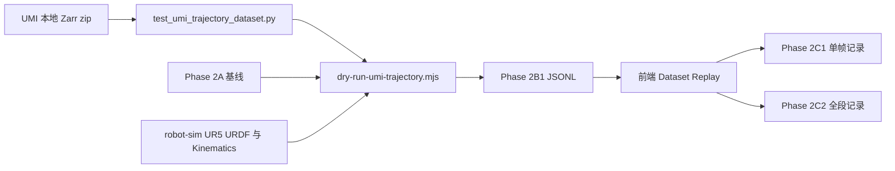

# robot-sim 实验报告

本目录保存 UR5 UMI 轨迹检查、浏览器 Kinematic Replay 和 Rapier wrist_3 诊断的结果。报告用于开发验证与复核；它们不代表真实 UR5 的标定或实机执行结果。

## UMI 轨迹与浏览器回放

| 报告 | 目的、输入与入口 | 输出、运行依赖与覆盖风险 |
| --- | --- | --- |
| [`phase2a-umi-episode0-frames0-99.jsonl`](./phase2a-umi-episode0-frames0-99.jsonl) | 记录 episode 0 前 100 帧的 UR5 TCP 位姿与 IK dry-run，作为 Phase 2B1 中 frame 0、65、99 的回归基线。首帧用于把数据轨迹合成对齐到 UR5 初始位姿。 | 是 Phase 2B1 脚本的本地输入；当前没有配套生成命令。合成对齐不等于 tag 到实体 UR5 base 的标定。浏览器在线策略推理不依赖它。 |
| [`phase2b1-umi-episode0-frames0-399.jsonl`](./phase2b1-umi-episode0-frames0-399.jsonl) | 由 `cd robot-sim && node scripts/dry-run-umi-trajectory.mjs` 生成。读取 UMI 本地数据集 `universal_manipulation_interface/data/cup_in_the_wild.zarr.zip`、Phase 2A 基线、`assets/ur_description/urdf/ur5.urdf` 和当前 UR5 `Kinematics`；首帧按 UR5 初始位姿合成对齐，后续帧以上一帧 IK 解作 Seed。 | 保存 400 帧目标位姿、IK 解、连续性和关节限位检查。**`src/app/datasetReplay.ts` 将此文件作为静态资源直接导入，Dataset Replay 页面依赖它，不能删除。** 重新运行脚本会整体覆盖此文件；当前结果应先另行保存。它不是在线 UMI 策略推理的 Zarr 输入，但属于前端 Dataset Replay 功能的资源输入。 |
| [`phase2b2-2-rapier-motor-gain-sweep.json`](./phase2b2-2-rapier-motor-gain-sweep.json) | 记录固定 UR5 关节目标在重力下的 Rapier position motor 增益对比。结果来自临时浏览器运行时采样，没有仓库内的专用复现命令；记录注明未设置机器人 collider，且 sweep 未永久改动增益。 | 保存多组 stiffness/damping 的关节读回、误差、速度和 TCP 误差。需要 robot-sim 的 UR5/Rapier 环境；不依赖 UMI 数据集，也不是正式运行依赖。仓库脚本不会自动覆盖此 JSON。 |
| [`phase2b23-wrist3-positive-stop.md`](./phase2b23-wrist3-positive-stop.md) | 记录 wrist_3 正方向诊断。浏览器入口为 `pnpm dev` 后选 UR5 并使用 `?phase2b23=1`；`gravity=off`、`collisions=off`、`lockUpstream=1` 和正整数 `solverIterations` 可控制诊断条件。 | 正方向 motor 命令下，实际读回回落至零附近并出现 body/FK 暂态差异，因此停止其余方向、隔离和 solver 检查。浏览器诊断数据保存在页面内存，README 报告需手工归档；没有自动覆盖报告的命令。它不依赖 UMI 数据集，也不是正式运行依赖。 |
| [`phase2b24-wrist3-motor-target-and-body-angle.md`](./phase2b24-wrist3-motor-target-and-body-angle.md) 与 [`phase2b24-wrist3-motor-trace.jsonl`](./phase2b24-wrist3-motor-trace.jsonl) | 记录 `?phase2b24=1&gravity=off&collisions=off` 条件下 wrist_3 motor 写入，以及刚体世界旋转和 Rapier 关节坐标系的独立角度检查点；采样时长 20 秒。 | MD 为实验结论，JSONL 为 motor 写入与时点样本；另有 [`phase2b24-wrist3-motor-trace.png`](../screenshots/phase2b24-wrist3-motor-trace.png)。运行时 trace 暂存在 `window.__ROBOT_SIM_PHASE2B24__`，页面不会自动写入本目录。重跑浏览器诊断不会覆盖已归档文件；手动导出时应保留现有报告。它不依赖 UMI 数据集，也不是正式运行依赖。 |
| [`phase2c1-umi-episode0-frame0.json`](./phase2c1-umi-episode0-frame0.json) | 在浏览器 Dataset Replay 面板载入 episode 0，并记录 frame 0 的 `KINEMATIC_REPLAY`。读取 Phase 2B1 中已对齐的目标和 IK 解。 | 运行结果暂存在 `window.__ROBOT_SIM_DATASET_REPLAY__`；归档 JSON 保存关节命令/读回、`q_body` 与 TCP 误差。该次停在 frame 0，没有继续播放。浏览器操作不写入或覆盖报告文件；页面重载会清除内存状态。不是在线策略推理依赖。 |
| [`phase2c2-umi-episode0-frames0-399.json`](./phase2c2-umi-episode0-frames0-399.json) | 同一浏览器入口完成 episode 0 的 0–399 帧 `KINEMATIC_REPLAY`，仍使用 Phase 2B1 预计算 IK。 | 运行结果暂存在 `window.__ROBOT_SIM_DATASET_REPLAY__`；归档 JSON 保存逐帧关节命令/读回、TCP 与关节误差、异常检查和摘要。它是 Kinematic Replay 结果，不证明 Rapier motor 或实体机器人能跟踪目标。浏览器操作不写入或覆盖报告文件；页面重载会清除内存状态。不是在线策略推理依赖。 |

Phase 2C 截图分别见 [`phase2c1`](../screenshots/phase2c1-umi-episode0-frame0.png) 和 [`phase2c2`](../screenshots/phase2c2-umi-episode0-frames0-399.png)。Phase 2B-2.3/2.4 截图见 [`screenshots/README.md`](../screenshots/README.md)。

## 其他 IK 诊断

[`../scripts/replay-ik-multiseed.mjs`](../scripts/replay-ik-multiseed.mjs) 的入口为 `cd robot-sim && pnpm ik:multiseed`。它读取本地 `server/logs/ik-debug.jsonl`、`server/logs/inference-predictions.jsonl` 和 RS URDF，固定最近一次 `no_joint_motion` 失败的目标及 IK options，复现原 Seed 后再比较其他合法 Seed。忽略的运行日志是实验输入，丢失后无法按原故障复现。脚本会覆盖 [`server/logs/ik-multiseed-results.json`](../server/logs/ik-multiseed-results.json) 和 [`../ik_multiseed_experiment.md`](../ik_multiseed_experiment.md)；需要保留当前结果时，运行前先保存副本。该诊断不在正式推理和动作执行调用链中。

## 依赖与覆盖提示

- 浏览器 Dataset Replay 会把 Phase 2B1 报告作为前端资源导入；删掉该文件会破坏此功能和前端构建。
- `node scripts/dry-run-umi-trajectory.mjs` 会重写 Phase 2B1 报告。它依赖本地 UMI Zarr zip、Phase 2A 基线、UR5 URDF、robot-sim 的 IK 实现及可导入 NumPy/SciPy/Zarr 的 Python 环境。
- `pnpm ik:multiseed` 会重写 IK Multi-seed JSON 和 Markdown 两份结果，且依赖被忽略的本地运行日志。
- 浏览器 wrist_3/Rapier 和 Dataset Replay 操作只在页面内存中生成诊断状态；本目录里的 JSON、JSONL、Markdown 和截图是归档结果，不会被这些页面操作自动覆盖。
